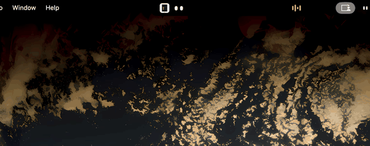

# Qaqash



Your little companion that lives in your Mac's notch. A pair of eyes keeps you in the loop, and the notch grows like the iPhone's Dynamic Island when something needs you.

Today it works with Claude Code and your music. VS Code, Telegram, WhatsApp, Mail and terminal notifications are coming next.

Everything runs on your Mac. No account, no cloud, no telemetry.

## What it does

- **Status at a glance:** the eyes change with Claude's mood: working, needs you, done.
- **Allow or Deny from the notch:** permission requests open in the island with round ✕ / ✓ buttons, so you don't have to switch windows.
- **Answer Claude's questions:** one question at a time, with the recommended option marked.
- **Sessions on hover:** hover the island to see every running Claude Code session and what it's doing. Click one to jump to its app.
- **Music:** shows what Spotify or Apple Music is playing, with the cover, tinted bars and playback controls.
- **Sounds:** a ping when Claude needs you, a chime when it's done.
- **Quiet in the Claude app:** while the Claude desktop app is in front, Qaqash stays out of the way.
- **iPhone app (in progress):** an iPhone app with notifications, Allow/Deny and a Live Activity is being built. The Mac side pairs with a QR code from the menu bar icon → **Pair iPhone…**.

## Requirements

- macOS 14 or later, ideally a Mac with a notch
- [Rust](https://rustup.rs) and [Node.js](https://nodejs.org) 20+
- Claude Code

## Run it

```bash
npm install
npm run tauri dev
```

## Connect it to Claude Code

Qaqash listens to Claude Code through [hooks](https://docs.claude.com/en/docs/claude-code/hooks). Merge the entries from [`claude-hooks.example.json`](claude-hooks.example.json) into the `hooks` section of `~/.claude/settings.json`, and change the path to `scripts/hook.sh` to where you cloned this repo.

If Qaqash isn't running, the hook does nothing and Claude Code behaves normally.

## iPhone app

The iPhone app lives in `ios/`. It needs [XcodeGen](https://github.com/yonaskolb/XcodeGen) (`brew install xcodegen`):

```bash
cd ios
xcodegen generate
open Qaqash.xcodeproj
```

Pick your phone and press Run. Then pair it from the Mac's menu bar icon → **Pair iPhone…**.

## How it works

```
Claude Code ── hook.sh ──> Qaqash (127.0.0.1:47831) ──> the island
                                │
                                └── Wi-Fi (47832, TLS, paired) ──> iPhone
```

- `scripts/hook.sh` sends each hook event to Qaqash. For permission requests and questions, Qaqash holds the request until you answer, then replies to Claude Code.
- The window is a fixed transparent area at the top of the screen that lets clicks through everywhere except the island.
- Music is read with AppleScript, and only from apps that are already running, so Qaqash never launches them.

## Project layout

| Path | What's there |
|---|---|
| `src/` | The island's frontend (TypeScript), one file per feature |
| `src/styles/` | Styles, one file per feature |
| `src-tauri/src/` | The Rust backend: hook server, window, music, phone link, menu bar |
| `scripts/hook.sh` | The Claude Code hook |
| `pair.html` | The iPhone pairing window |
| `ios/` | The iPhone app and its Live Activity (SwiftUI) |

## Privacy

Qaqash makes no network calls beyond your own Mac and your local Wi-Fi, with one exception: Spotify cover images load from Spotify's image server (`i.scdn.co`).

## License

[MIT](LICENSE)
